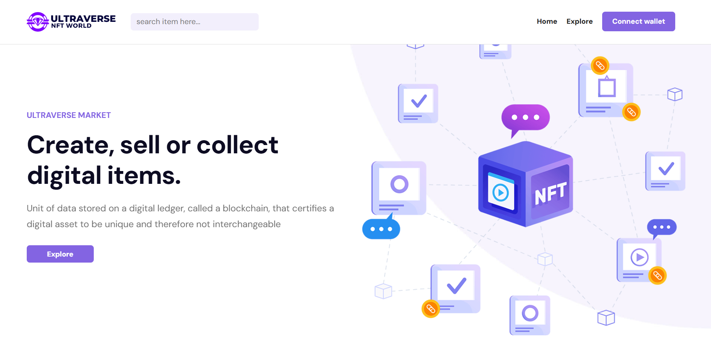

</> Markdown

## NFT Marketplace Platform Screenshot



## 🛠️ Tech Stack

* React 19 – component-based user interface
* React Router – dynamic author and item pages
* Axios – fetches live NFT API data
* REST API – serves collections, items, and authors
* React Slick – carousels for collections and items
* AOS – animations triggered while scrolling
* React Icons – lightweight icon library
* Bootstrap / CSS – responsive layout and styling
* Vercel – hosting and deployment
### 🚀 Key Features

* 🔥 Hot Collections carousel: swipe through trending NFT collections
* 🆕 New Items showcase: the latest NFTs with live auction countdowns
* ⏳ Live countdown timers: real-time auction end times on items
* 🏆 Top Sellers: highlights the best-performing creators
* 🔍 Explore & filter: sort NFTs by price or likes
* 👤 Author profiles: dynamic pages showing each creator's collection
* 🖼️ Item details: full NFT info, owner, creator, and price
* 🗂️ Browse by category: quick links into NFT categories
* 💀 Skeleton loading: smooth placeholders while API data loads
* 🌐 Live API data: content fetched from REST endpoints with Axios
* ✨ Scroll animations: AOS effects as you scroll
* 📱 Responsive design: works on desktop, tablet, and mobile

## NFT Marketplace Platform

🔗 **Live Demo:** [View Live Website](https://julius-internship-excellentgoldpear.vercel.app/)

A React application that allows users to discover, explore, and view digital NFT collections.

# NFT Marketplace Platform Run Instructions

# Installation and Setup Guide

Follow these instructions to install, configure, and run the NFT Marketplace project locally on a Windows computer using Visual Studio Code.

## 1. Prerequisites

Before getting started, make sure the following software is installed.

### Required Software

| Software | Required Version | Purpose |
|---|---|---|
| Node.js | 20.9 or higher | JavaScript runtime environment |
| npm | Included with Node.js | Dependency and package management |
| Visual Studio Code | Latest version | Code editor and development environment |
| Git | Latest version | Source control and repository management |

### Verify Your Installation

Open Windows Terminal, PowerShell, or the VS Code integrated terminal.

Run the following commands:

```bash
node --version
```

Expected output:

```bash
v20.9.0
```

Check npm:

```bash
npm --version
```

Check Git:

```bash
git --version
```

If these commands return version numbers, your development environment is ready.

## 2. Clone or Download the Project

If you are downloading the project from GitHub, open your terminal and navigate to the directory where you want to store your projects.

Clone the repository:

```bash
git clone YOUR_GITHUB_REPOSITORY_URL
```

Navigate into the project directory:

```bash
cd YOUR_PROJECT_FOLDER
```

Alternatively, download the repository as a ZIP file from GitHub and extract it to your preferred development directory.

## 3. Open the Project in Visual Studio Code

From your project directory, execute:

```bash
code .
```

Alternatively:

1. Open Visual Studio Code.
2. Select **File → Open Folder**.
3. Navigate to the extracted project directory.
4. Select the project folder.
5. Click **Select Folder**.

The project should now appear in the VS Code Explorer.

## 4. Install Project Dependencies

This project includes a `package.json` and `package-lock.json` file.

These files contain the project's dependency information and help ensure consistent package installations.

Open the integrated VS Code terminal:

**Terminal → New Terminal**

Make sure the terminal is located in the project's root directory.

Run:

```bash
npm install
```

This command installs the dependencies listed in `package.json` and restores the packages required to run the application.

For subsequent installations where you want to use the exact dependency versions recorded in `package-lock.json`, run:

```bash
npm ci
```

**Important:** Use `npm ci` when setting up a clean environment or installing dependencies in a CI/CD pipeline. It requires the lockfile to match `package.json` and replaces the existing `node_modules` directory.

## 5. Configure Environment Variables

Check the project root directory for the following files:

- `.env`
- `.env.example`
- `.env.local`

No environment variable files were included in the supplied project structure.

If the application does not require environment variables, you can skip this section.

If API credentials or external service configuration are required:

1. Create a `.env` file in the project root.
2. Add the required environment variables.
3. Save the file.
4. Restart the development server.

For a Create React App project, environment variables exposed to frontend code must begin with `REACT_APP_`.

Example:

```env
REACT_APP_API_URL=https://your-api-endpoint.com
```

Access the variable in your React application using:

```javascript
process.env.REACT_APP_API_URL
```

Never commit private API keys, passwords, or secret credentials to GitHub.

Add `.env` to your `.gitignore` file if it is not already included.

**Note:** Only configure environment variables that the actual application requires. The example above is illustrative, not a confirmed project requirement.

## 6. Run the Application in Development Mode

After installing the dependencies, start the development server.

For a standard Create React App configuration, execute:

```bash
npm start
```

This command starts the React development server.

Once the application compiles successfully, open your browser and navigate to:

```text
http://localhost:3000
```

The application should now be running locally.

### Automatic Reloading

The development server supports automatic browser refreshing when you save changes to your React components, JavaScript files, or CSS stylesheets.

For example, modifying:

```text
src/App.jsx
```

or:

```text
src/components/Nav.jsx
```

should trigger an update in the browser.

**Important:** The `npm start` command assumes the project has a `start` script configured in `package.json`. Verify this before running it.

## 7. Build the Application for Production

When you are ready to prepare the application for deployment, execute:

```bash
npm run build
```

For a standard Create React App project, this generates an optimized production build inside a directory named:

```text
build/
```

The production build contains optimized JavaScript, CSS, and other application assets.

You can then deploy the generated build directory to a compatible hosting provider.

## 8. Run and Debug the Project Using VS Code

Visual Studio Code includes built-in JavaScript debugging capabilities.

You can use these capabilities to troubleshoot React components, inspect variables, and identify errors.

### Option A: Debug Using the Integrated Terminal

1. Open the project in Visual Studio Code.
2. Select **Terminal → New Terminal**.
3. Execute:

```bash
npm start
```

4. Open the application in your browser.
5. Open the browser's Developer Tools by pressing:

```text
F12
```

6. Select the Console tab to inspect JavaScript errors and application warnings.

### Option B: Configure the VS Code Debugger

If the project does not already contain a `.vscode` directory, create one in the project root.

Inside `.vscode`, create a file named:

```text
launch.json
```

Add the following configuration:

```json
{
  "version": "0.2.0",
  "configurations": [
    {
      "name": "Debug React Application (Chrome)",
      "type": "chrome",
      "request": "launch",
      "url": "http://localhost:3000",
      "webRoot": "${workspaceFolder}/src"
    }
  ]
}
```

**Note:** This configuration requires a compatible Chrome debugging extension, such as Debugger for Chrome. Alternatively, use VS Code's built-in JavaScript debugger with a supported browser configuration.

### Start Debugging

1. Start the React development server:

```bash
npm start
```

2. Open the Run and Debug panel in VS Code.
3. Select the `Debug React Application (Chrome)` configuration.
4. Press `F5` to start debugging.
5. Set breakpoints in your React components or JavaScript files.
6. Interact with the application to inspect execution and troubleshoot issues.

## 9. Useful Development Commands

Here are some commonly used commands for maintaining the project.

| Command | Description |
|---|---|
| `npm install` | Installs project dependencies |
| `npm ci` | Performs a clean dependency installation |
| `npm start` | Starts the development server |
| `npm run build` | Generates an optimized production build |
| `npm test` | Runs the configured test suite |
| `npm run lint` | Runs the linting script, if configured |

Not all commands are necessarily configured in this project. Check `package.json` before running optional scripts.

## 10. Troubleshooting Common Issues

### Issue 1: npm is not recognized

**Possible cause:** Node.js is not installed correctly or has not been added to the Windows PATH environment variable.

**Solution:**

1. Install or reinstall Node.js.
2. Restart Visual Studio Code.
3. Open a new terminal.
4. Execute:

```bash
node --version
npm --version
```

### Issue 2: Missing dependencies

**Possible cause:** Dependencies have not been installed or the `node_modules` directory is incomplete.

**Solution:**

```bash
npm install
```

### Issue 3: Port 3000 is already in use

**Possible cause:** Another application is already running on port 3000.

**Solution:**

Stop the existing development server or select another available port when prompted.

### Issue 4: Application fails to compile

**Possible cause:** Missing dependencies, incorrect imports, syntax errors, or incompatible package versions.

**Solution:**

1. Review the terminal output.
2. Check the VS Code Problems panel.
3. Verify component imports and file paths.
4. Confirm that all required dependencies are installed.

### Issue 5: Images or fonts are not displaying

**Possible cause:** Incorrect asset paths or missing files.

**Solution:**

Verify that image references and font URLs point to the correct locations.

For example:

```javascript

```

For assets located inside `src`, use the appropriate relative imports.

---

## 11. Project Structure Overview

The application follows a component-based React architecture.

| Directory/File | Description |
|---|---|
| `public/` | Static assets, HTML entry point, and application icons |
| `public/images/` | Public image assets |
| `src/components/` | Reusable React components |
| `src/components/author/` | Author-related components |
| `src/components/explore/` | NFT exploration components |
| `src/components/home/` | Homepage sections and components |
| `src/components/UI/` | Reusable interface components and loading skeletons |
| `src/css/` | Stylesheets, fonts, Bootstrap, and icon libraries |
| `src/images/` | Application image assets |
| `src/pages/` | Main application pages |
| `src/App.jsx` | Main React application component |
| `src/index.js` | React application entry point |
| `src/index.css` | Global application styles |
| `package.json` | Project metadata, dependencies, and npm scripts |
| `package-lock.json` | Exact dependency version information |
| `README.md` | Project documentation |

---

## 12. Quick Start Summary

For developers who already have Node.js and Git installed, follow these commands to get started quickly:

```bash
# Clone the repository
git clone YOUR_GITHUB_REPOSITORY_URL

# Navigate into the project
cd YOUR_PROJECT_FOLDER

# Install dependencies
npm install

# Start the development server
npm start
```

Open your browser:

```text
http://localhost:3000
```

To generate the production build:

```bash
npm run build
```

**You're all set!** The NFT Marketplace project should now be installed and running locally in your development environment.
