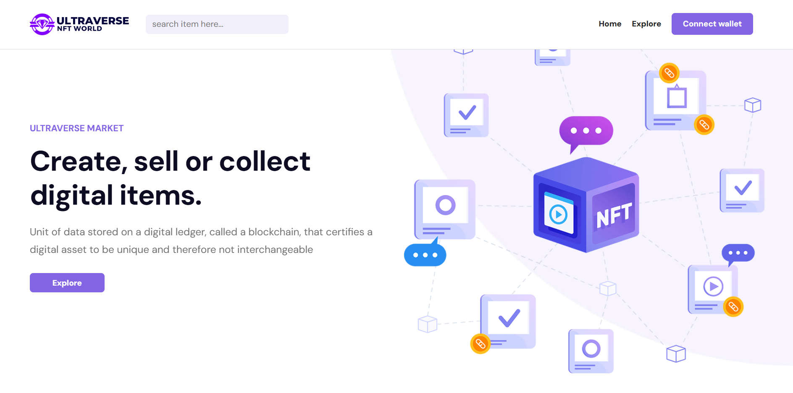

</> Markdown

## NFT Marketplace Platform Screenshot



## 🛠️ Tech Stack

* React — User interface development.
* REST API — Communication with web services through REST endpoints.

### 🚀 Key Features

*  📚 NFT Collection Discovery: Explore and discover unique digital NFT collections through an engaging and user-friendly interface.
*  ⚡ Responsive Design: Enjoy a seamless browsing experience across desktop, tablet, and mobile devices.
*  🎯 Interactive NFT Gallery: View digital artwork and NFT collections with a clean, modern layout designed for easy navigation.

## NFT Marketplace Platform

🔗 **Live Demo:** [View Live Website](https://julius-internship-excellentgoldpear.vercel.app/)

A React application that allows users to discover, explore, and view digital NFT collections.

# NFT Marketplace Platform Run Instructions

A React-based NFT Marketplace Platform designed to showcase digital collectibles, explore NFT collections, discover creators, and browse NFT-related content through a responsive user interface.

## Prerequisites

Before installing the project, ensure you have the following tools installed.

### 1. Node.js and npm

Install a compatible Node.js version from the official website:

https://nodejs.org/

npm is included with Node.js.

Verify your installations:

```bash
node -v
npm -v
```

Both commands should display version numbers.

**Recommendation:** Use a Node.js version compatible with React 19 and Create React App 5. If you encounter dependency or compatibility errors, check the requirements of the installed packages.

### 2. Git

Git is required to clone the repository. If you already have the project files, you can skip this requirement.

Download Git:

https://git-scm.com/

Verify the installation:

```bash
git --version
```

### 3. Visual Studio Code

Visual Studio Code is recommended for opening, editing, and managing the project.

Download it here:

https://code.visualstudio.com/

---

## Installation and Setup

Follow these steps to run the NFT Marketplace Platform on your local computer.

### Step 1: Clone the Repository

Open your terminal and run:

```bash
git clone https://github.com/jkarnwie2000/julius-internship.git
```

Navigate into the project directory:

```bash
cd julius-internship
```

### Step 2: Install Dependencies

Install the dependencies specified in `package-lock.json`:

```bash
npm ci
```

This installs the project's dependencies without intentionally updating the existing lockfile.

If `npm ci` fails because the lockfile is missing or inconsistent with `package.json`, run:

```bash
npm install
```

Wait for the installation to finish before proceeding.

### Step 3: Start the Development Server

Run the following command:

```bash
npm start
```

Because this project uses Create React App, the command starts the React development server.

Your browser should open automatically at:

**http://localhost:3000**

If it does not, enter that address in your browser.

The development server automatically recompiles supported changes as you edit your source files.

To stop the server, press `Ctrl + C` in the terminal.

---

## Environment Variables

The project uses Axios for HTTP requests, but its `package.json` does not specify which REST API endpoint the application uses.

If your source code requires a configurable API URL, you can define it using an environment variable.

### Step 1: Create a `.env` File

Create a file named `.env` in the project root, alongside `package.json`.

Example:

```dotenv
REACT_APP_API_BASE_URL=https://your-api.example.com
```

Replace the example URL with your actual API endpoint.

### Step 2: Access the Variable in React

For this Create React App project, you can access the variable as follows:

```javascript
const API_BASE_URL = process.env.REACT_APP_API_BASE_URL;
```

For example, if you use Axios:

```javascript
import axios from "axios";

const api = axios.create({
  baseURL: process.env.REACT_APP_API_BASE_URL,
});

export default api;
```

This example illustrates an optional API client configuration. Use it only if it matches your existing API implementation.

### Step 3: Restart the Development Server

If you create or modify `.env`, stop the running development server and restart it:

```bash
npm start
```

### Environment Variable Notes

* Environment variables must use the `REACT_APP_` prefix to be exposed to Create React App application code.
* A `.env` file is unnecessary if the application does not read environment variables.
* Do not place passwords, private API keys, or other confidential secrets in frontend environment variables.
* Add `.env` to `.gitignore` if it is not already excluded from version control.
* If the API URL is already defined in the source code, update the existing configuration instead of creating a duplicate.

---

## Running the Application

### Development Mode

Use development mode when developing, testing, or debugging the application.

```bash
npm start
```

Open the local development address:

http://localhost:3000

### Production Build

Create an optimized production build by running:

```bash
npm run build
```

Your `package.json` defines the build script as:

```json
"build": "CI= react-scripts build"
```

This invokes the Create React App production build process.

The generated production files will normally be placed in:

```text
build/
```

**Note:** The `CI=` prefix is shell-specific and is commonly used in Unix-like environments to clear the `CI` environment variable. If the build command fails in Windows Command Prompt or PowerShell, the environment-variable syntax may need to be adjusted.

### Preview the Production Build

After successfully building the application, you can preview it using a static file server.

Install `serve` globally if it is not already installed:

```bash
npm install -g serve
```

Run the production build:

```bash
serve -s build
```

Open the local URL displayed in your terminal.

The `-s` option enables single-page application fallback behavior, which is useful for client-side routing.

To stop the server, press `Ctrl + C`.

**Important:** Running the production build locally does not deploy the application to the internet. To publish it, deploy the generated `build/` directory to a compatible static hosting provider.

---

## Available npm Scripts

The following commands are defined in your `package.json`.

| Command         | Description                                    |
| --------------- | ---------------------------------------------- |
| `npm start`     | Starts the Create React App development server |
| `npm run build` | Generates an optimized production build        |
| `npm test`      | Starts the configured test runner              |
| `npm run eject` | Exposes the underlying build configuration     |

**Warning:** `npm run eject` is a one-way operation that copies the hidden Create React App configuration into your project. Most applications do not need to eject.

---

## Project Structure

```text
julius-internship/
├── public/
│   ├── images/
│   │   ├── nft.png
│   │   └── nft.webp
│   ├── favicon.ico
│   ├── index.html
│   ├── logo192.png
│   ├── logo512.png
│   ├── manifest.json
│   └── robots.txt
├── src/
│   ├── components/
│   │   ├── author/
│   │   ├── explore/
│   │   ├── home/
│   │   ├── UI/
│   │   ├── Footer.jsx
│   │   └── Nav.jsx
│   ├── css/
│   │   ├── colors/
│   │   ├── fonts/
│   │   └── styles/
│   ├── images/
│   ├── pages/
│   ├── App.jsx
│   ├── index.css
│   ├── index.js
│   └── reportWebVitals.js
├── image-credits.txt
├── package.json
├── package-lock.json
└── README.md
```

### Key Directories

* **`public/`** — Contains static assets served directly by the application.
* **`src/components/`** — Contains reusable components for NFT listings, navigation, creators, and other interface sections.
* **`src/pages/`** — Contains the main page-level components.
* **`src/css/`** — Contains stylesheets, themes, fonts, and icon libraries.
* **`src/images/`** — Contains images imported into React components.
* **`package.json`** — Defines dependencies and npm scripts.
* **`package-lock.json`** — Records the dependency tree used by npm.
* **`image-credits.txt`** — Contains image attribution information.

---

## Troubleshooting

### 1. `npm` Is Not Recognized

**Cause:** Node.js may not be installed correctly or may not be available through your system's PATH.

**Solution:**

1. Install Node.js.
2. Restart your terminal.
3. Run:

```bash
node -v
npm -v
```

### 2. `npm ci` Fails

**Cause:** The lockfile may be missing or inconsistent with `package.json`.

**Solution:**

Run:

```bash
npm install
```

If installation succeeds, start the application:

```bash
npm start
```

### 3. `npm start` Fails

**Cause:** Dependencies may not be installed correctly.

**Solution:**

Run:

```bash
npm install
npm start
```

If the error persists, inspect the terminal output for missing dependencies, incompatible Node.js versions, or compilation errors.

### 4. Images Do Not Display

For images inside `public/images/`, reference the public URL:

```jsx

```

For images inside `src/images/`, import the image using the correct relative path:

```jsx
import nftImage from "../../images/nftImage.jpg";
```

Ensure that the image exists at the referenced location and that the filename and extension match exactly.

### 5. REST API Requests Fail

If NFT data does not load:

1. Open your browser's developer tools.
2. Select the **Network** tab.
3. Reload the application.
4. Inspect failed API requests.
5. Verify the endpoint, HTTP status code, and response body.
6. Check whether the API requires authentication.
7. Investigate CORS errors if the browser blocks cross-origin requests.

An API endpoint may be unavailable even when the React application itself starts successfully.

### 6. Blank Page or React Errors

Open the browser's developer tools and inspect the **Console** tab.

Check for:

* Missing imports or modules.
* JavaScript runtime errors.
* Incorrect component paths.
* Failed API requests.
* Routing or rendering errors.

Resolve the reported error and reload the application.

### 7. Port 3000 Is Already in Use

If another application is using port 3000, Create React App may prompt you to use another port.

Accept the alternative port or stop the application using port 3000.

### 8. Production Build Fails on Windows

Your current build script contains:

```json
"build": "CI= react-scripts build"
```

The `CI=` syntax is not portable across Windows shells.

If you need to make the script work across Windows and Unix-like environments, consider installing `cross-env`:

```bash
npm install --save-dev cross-env
```

Then update the build script in `package.json` to:

```json
"build": "cross-env CI= react-scripts build"
```

This is an optional adjustment. Before changing the script, confirm that your existing build actually fails on your Windows environment.

---

## Contributing

Contributions, suggestions, and bug reports are welcome.

1. Fork the repository.
2. Create a feature branch.
3. Make your changes.
4. Test the application.
5. Submit a pull request.

## License

This project specifies the ISC license in `package.json`. Consult the repository's licensing files and distribution terms before reusing or redistributing the code.

## Acknowledgments

Refer to `image-credits.txt` for image attribution information.

# Getting Started with Create React App

This project was bootstrapped with [Create React App](https://github.com/facebook/create-react-app).

## Available Scripts

In the project directory, you can run:

### `npm start`

Runs the app in the development mode.\
Open [http://localhost:3000](http://localhost:3000) to view it in your browser.

The page will reload when you make changes.\
You may also see any lint errors in the console.

### `npm test`

Launches the test runner in the interactive watch mode.\
See the section about [running tests](https://facebook.github.io/create-react-app/docs/running-tests) for more information.

### `npm run build`

Builds the app for production to the `build` folder.\
It correctly bundles React in production mode and optimizes the build for the best performance.

The build is minified and the filenames include the hashes.\
Your app is ready to be deployed!

See the section about [deployment](https://facebook.github.io/create-react-app/docs/deployment) for more information.

### `npm run eject`

**Note: this is a one-way operation. Once you `eject`, you can't go back!**

If you aren't satisfied with the build tool and configuration choices, you can `eject` at any time. This command will remove the single build dependency from your project.

Instead, it will copy all the configuration files and the transitive dependencies (webpack, Babel, ESLint, etc) right into your project so you have full control over them. All of the commands except `eject` will still work, but they will point to the copied scripts so you can tweak them. At this point you're on your own.

You don't have to ever use `eject`. The curated feature set is suitable for small and middle deployments, and you shouldn't feel obligated to use this feature. However we understand that this tool wouldn't be useful if you couldn't customize it when you are ready for it.

## Learn More

You can learn more in the [Create React App documentation](https://facebook.github.io/create-react-app/docs/getting-started).

To learn React, check out the [React documentation](https://reactjs.org/).

### Code Splitting

This section has moved here: [https://facebook.github.io/create-react-app/docs/code-splitting](https://facebook.github.io/create-react-app/docs/code-splitting)

### Analyzing the Bundle Size

This section has moved here: [https://facebook.github.io/create-react-app/docs/analyzing-the-bundle-size](https://facebook.github.io/create-react-app/docs/analyzing-the-bundle-size)

### Making a Progressive Web App

This section has moved here: [https://facebook.github.io/create-react-app/docs/making-a-progressive-web-app](https://facebook.github.io/create-react-app/docs/making-a-progressive-web-app)

### Advanced Configuration

This section has moved here: [https://facebook.github.io/create-react-app/docs/advanced-configuration](https://facebook.github.io/create-react-app/docs/advanced-configuration)

### Deployment

This section has moved here: [https://facebook.github.io/create-react-app/docs/deployment](https://facebook.github.io/create-react-app/docs/deployment)

### `npm run build` fails to minify

This section has moved here: [https://facebook.github.io/create-react-app/docs/troubleshooting#npm-run-build-fails-to-minify](https://facebook.github.io/create-react-app/docs/troubleshooting#npm-run-build-fails-to-minify)

## Successfully Completed Accessibility Audit on Website 
Audited project with Lighthouse and axe DevTools and adjusted contrast, alt text, form labels, and focus states, to bring the accessibility score from the initial 78% to 100%, to ensure a smooth browsing experience for text readers and users.

## Successfully Improved Performance of Website
I ran performance audit and corrected the LCP element to take website performance from 83% to 95%.
